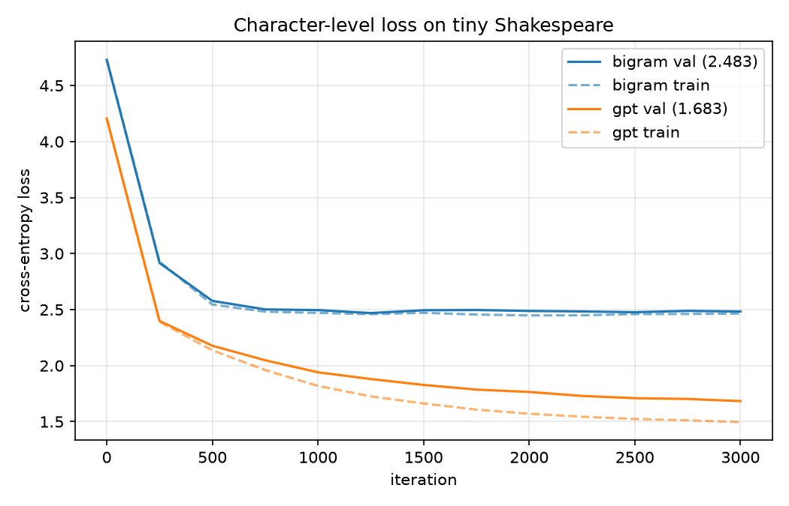

# mini-gpt

A small GPT-style language model written from scratch in PyTorch, then profiled
and optimized (mixed precision, `torch.compile`, KV cache, and a custom kernel).

**Status:** Week 2 of 6 — multi-head causal self-attention and a full GPT.

## Quick start (macOS/Linux/WSL)

```bash
python3 -m venv .venv && source .venv/bin/activate
pip install -r requirements.txt

pytest -q                               # run all tests
python train.py --model bigram          # Week 1 baseline
python train.py --model gpt             # transformer (uses Apple GPU / CUDA if available)
python generate.py --prompt "ROMEO:" --temperature 0.8 --top-k 20
python plot_loss.py                     # writes loss_curve.png
```

## Layout

```
minigpt/
  tokenizer.py    character-level tokenizer
  data.py         download, train/val split, random batches
  model.py        bigram baseline
  gpt.py          GPT: causal self-attention, MLP, transformer blocks
  checkpoint.py   build models from a config, save/load checkpoints
train.py          AdamW, LR warmup + cosine decay, gradient clipping, eval
generate.py       sampling with a prompt, temperature and top-k
plot_loss.py      loss curves for every trained model
tests/            unit tests (attention is checked against PyTorch's built-in)
LOG.md            running notes
```

## Results

Character-level tiny Shakespeare, 90/10 train/val split.

| Model | Params | Context | Val loss |
|-------|--------|---------|----------|
| Uniform guess (ln 65) | – | – | 4.17 |
| Bigram (week 1) | 4,225 | 1 char | 2.483 |
| GPT, 4 layers × 4 heads × 128 dim (week 2) | 818,048 | 128 chars | 1.6834 |



## Roadmap

1. ~~Bigram baseline and training loop~~
2. Transformer: attention, blocks, full GPT (this week)
3. Real dataset (Python code), BPE, experiments
4. Profiling and optimization
5. KV cache and a Triton kernel
6. Roofline analysis, polish
